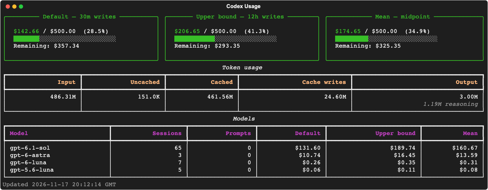

# Codex Usage Tracker

A local-only macOS CLI that estimates OpenAI API cost from Codex JSONL rollout files. It never sends session data over the network and never reads message content beyond identifying prompt events.

## Who is this for?

This tool is designed specifically for people who interact with OpenAI API using Codex through **managed, institutional, or enterprise proxy keys** (such as keys issued by universities or companies) with monthly or annual quotas but no direct access to the OpenAI API dashboard.



## Setup

```bash
uv tool install .
codex-usage
```

`uv tool install` keeps the installed CLI independent of the project folder. Re-run `uv tool install --force .` after changing the source code.

The default dashboard shows three estimates for the current calendar month,
each against `monthly_budget_usd` in `pricing.toml`:

- **Default:** all cache writes priced at the 30-minute rate.
- **Upper bound:** all cache writes priced at the 12-hour rate.
- **Mean:** the arithmetic midpoint of those two estimates, not a predicted bill.

The Models table shows the same three costs per model. Panels stay side by side
while their contents fit, and stack vertically only when more space is needed.

Useful commands:

```bash
codex-usage watch
codex-usage report --period month
codex-usage report --period all --model gpt-5.6-terra
codex-usage report --period month --json
codex-usage models
codex-usage doctor
codex-usage --show-parser-warnings report
```

For development and testing:

```bash
uv sync --group dev --no-editable
uv run --no-sync pytest
```

## A note on Codex logs

The CLI tool can parse archived chats but not the ones that have been completely deleted. For an accurate estimate, keep the chats from the current month on your local machine.

Both plain `.jsonl` and Zstandard-compressed `.jsonl.zst` logs are read from
the active and archived session directories, including subdirectories.
Compression or moving a log to the archive preserves its usage. If plain and
compressed copies coexist, the tracker counts one copy per session ID, choosing
the one with the most decoded data rather than the largest compressed file.

Watch mode reads plain logs incrementally and caches unchanged compressed logs.
Run `codex-usage doctor` to see plain/compressed file counts and read errors,
including damaged compressed logs. These file counts are also included in JSON
report diagnostics. Parser and deduplication warnings are hidden in the normal
dashboard, watch mode and reports by default; pass the global
`--show-parser-warnings` option before a subcommand to show them. Unpriced-model
warnings and fatal errors remain visible.

## Pricing and accounting

Edit `pricing.toml` to change budgets, paths, prices or model aliases. Prices
are USD per one million tokens and are static by design.

Every short/long context price band requires both `cache_write_input` (30-minute
writes) and `cache_write_input_12h` (12-hour writes). Existing custom configurations
must add the latter from their provider's rate card. For example:

```toml
[models."gpt-6.2-sol".short]
input = "2.00"
cached_input = "0.10"
cache_write_input = "2.50"
cache_write_input_12h = "5.00"
output = "10.00"
```

The bundled prices use [Standard API pricing](https://developers.openai.com/api/docs/pricing),
checked on 17 November 2026. The context band is selected separately for each
request; only the cache-write rate changes between scenarios. Input and output
prices are not doubled to produce the upper bound.

The API reports cache writes separately by lifetime, but the Codex logs inspected
here store only a combined count. The tracker therefore estimates a range; it
cannot recover the exact lifetime mix. These estimates cover recorded, priced
activity and do not account for deleted logs or different proxy billing.
All-time reports apply the configured static prices across recorded history;
they do not reconstruct historical invoices or the availability of cache options.

Each `token_count.info.last_token_usage` record is one model request. The
cumulative `total_token_usage` field is intentionally ignored. Input is split
into mutually exclusive uncached, cached and cache-write categories; reasoning
tokens are already included in output tokens and are not charged again.

The Models table counts `user_message` events as **Prompts**. Internal API
requests are intentionally hidden from the normal interface because agentic
workflows can make several model calls for one prompt; they remain available as
`diagnostics.api_requests` in JSON output and continue to drive token costs.

If a model has no configured rate, its activity and tokens remain visible but
its cost is excluded. The CLI marks all three monetary totals as partial.

Reports support the `month` and `all` periods. JSON preserves `cost_usd` as the
default estimate and adds `cost_upper_usd` and `cost_mean_usd` to the report and
each model. Monetary values are decimal strings with full calculation precision.
The default `--json` output contains a single `month` object; activity statistics
and parser diagnostics remain available in JSON even when hidden visually.
